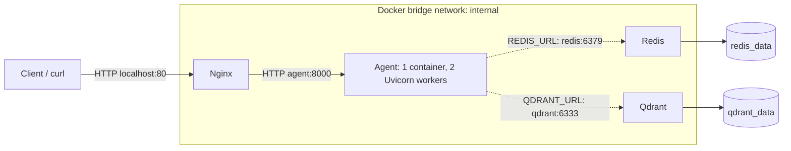
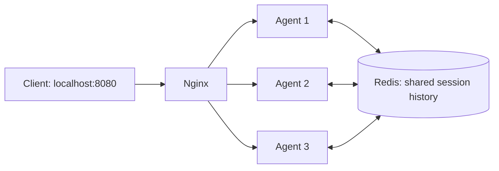

# Day 14 Lab — Mission Answers

- Học viên: Trần Quang Minh
- MSSV: 2A202603929 — Lớp: K5-L3B
- Ngày thực hiện Part 1: 26/11/2026
- Tiến độ: hoàn thành Part 1–6, gồm ba ảnh minh chứng deploy; Part 7 chưa hoàn thành.

## Part 1: Localhost vs Production

### Exercise 1.1 — Các anti-pattern trong bản develop

Đối chiếu trực tiếp với [develop/app.py](01-localhost-vs-production/develop/app.py):

| # | Vị trí trong `develop/app.py` | Vấn đề | Hậu quả và hướng khắc phục |
|---|---|---|---|
| 1 | Dòng 17–18 | Hardcode API key và URL database chứa thông tin đăng nhập. Đây là dữ liệu giả trong ví dụ. | Nếu dùng secret thật, push repo sẽ làm lộ quyền truy cập. Đọc secret từ biến môi trường; nếu đã lộ phải thu hồi và thay mới. |
| 2 | Dòng 21–22 | `DEBUG`, `MAX_TOKENS` được gán cố định, không có quản lý cấu hình tập trung. | Phải sửa code khi đổi môi trường. Dùng settings đọc biến môi trường và kiểm tra cấu hình khi khởi động. `DEBUG` hiện chỉ được khai báo; reload còn được bật cứng riêng ở dòng 53. |
| 3 | Dòng 34 | In API key ra log. | Người có quyền đọc log cũng có thể lấy secret. Không ghi secret vào log, kể cả khi debug. |
| 4 | Dòng 33, 38 | Dùng `print()` thay vì logging có level và cấu trúc. | Khó lọc lỗi, tìm request và tổng hợp log khi có nhiều instance. Dùng logging và formatter JSON hợp lệ. |
| 5 | Dòng 25–39; chú thích 42–43 | Không khai báo `/health` và `/ready`. | Hệ thống vận hành thiếu endpoint chuyên biệt để kiểm tra process và trạng thái sẵn sàng nhận tải. Bổ sung liveness/readiness. |
| 6 | Dòng 51 | Bind vào `localhost`. | Không nhận được kết nối qua network interface bên ngoài container. Bind `0.0.0.0` khi triển khai. |
| 7 | Dòng 52 | Port cố định 8000. | Không dùng được port do nền tảng cấp qua `PORT`. Đọc port từ biến môi trường. |
| 8 | Dòng 53 | `reload=True` được bật cố định. | Chạy thêm cơ chế theo dõi file và restart dành cho phát triển. Tắt reload trong production. |
| 9 | Toàn file | Không có lifecycle startup/shutdown để quản lý tài nguyên ứng dụng. | Khi bổ sung DB/client/model, cần nơi khởi tạo và đóng tài nguyên. Dùng lifespan; để Uvicorn điều phối shutdown và chờ request đang chạy. Không đồng nghĩa Uvicorn của bản develop hoàn toàn không có graceful shutdown. |

Ví dụ cải thiện có vị trí cụ thể: `develop/app.py:52` cố định `port=8000`; bản production dùng `settings.port` tại `production/app.py:197`, giá trị được đọc từ `PORT` tại `production/config.py:18`.

### Exercise 1.2 — Chạy và kiểm tra basic version

Đã chạy ứng dụng thật bằng `python app.py`, gửi request HTTP và dừng server sau khi kiểm tra. Môi trường cuối: **Python 3.12.14**, FastAPI **0.115.0**, Uvicorn **0.30.0**, python-dotenv **1.0.1**, cài trong `.venv/` đã được Git ignore. Không dùng API key thật; LLM là mock có sẵn.

Từ gốc repo, chạy basic bằng:

```bash
cd 01-localhost-vs-production/develop
../../.venv/bin/python app.py
```

Trong terminal khác:

```bash
curl -i http://localhost:8000/
curl -i -X POST 'http://localhost:8000/ask?question=docker'
curl -i http://localhost:8000/health
```

Kết quả thực tế:

| Request | HTTP | Response |
|---|---:|---|
| `GET /` | 200 | `{"message":"Hello! Agent is running on my machine :)"}` |
| `POST /ask?question=docker` | 200 | `{"answer":"Container là cách đóng gói app để chạy ở mọi nơi. Build once, run anywhere!"}` |
| `GET /health` | 404 | `{"detail":"Not Found"}` |

**Điểm lệch giữa lệnh trong đề và code:** `ask_agent(question: str)` tại `develop/app.py:31` nhận `question` qua query string. Gửi JSON như Exercise 1.2 không truyền được tham số này:

```bash
curl -i http://localhost:8000/ask -X POST \
  -H 'Content-Type: application/json' \
  -d '{"question":"docker"}'
```

Kết quả thực tế: **422**, với response:

```json
{"detail":[{"type":"missing","loc":["query","question"],"msg":"Field required","input":null}]}
```

Vì vậy dùng query string để chạy đúng bản basic hiện có, giữ nguyên source mẫu. Agent trả lời được nhưng chưa sẵn sàng cho production vì các vấn đề ở Exercise 1.1.

### Exercise 1.3 — So sánh với advanced version

Đã chạy bản production ở port **18001** để kiểm chứng `PORT` có hiệu lực. Đặt `DEBUG=false`, `ENVIRONMENT=production` và các key placeholder dùng riêng cho thử nghiệm local. `OPENAI_API_KEY` placeholder chỉ tránh cảnh báo thiếu cấu hình; code vẫn gọi mock LLM, không gọi dịch vụ bên ngoài. Không tạo hoặc commit `.env`.

Ứng dụng đọc cấu hình bằng `os.getenv`; chỉ copy `.env.example` thành `.env` chưa đủ để `python app.py` tự nạp file, vì code hiện không gọi `load_dotenv()`. Lượt chạy này truyền biến môi trường trực tiếp cho process.

| Feature | Basic — develop | Advanced — production | Tại sao quan trọng? |
|---|---|---|---|
| Config | Hằng số trong `app.py`. | `Settings` tập trung trong `config.py`, đọc env. | Đổi dev/staging/production mà không sửa source. |
| Secrets | Hardcode và in key ra log. | Đọc từ env; luồng xử lý request không in key. | Giảm nguy cơ lộ secret trong Git và log. |
| Host / port | `localhost:8000`. | `HOST` mặc định `0.0.0.0`, `PORT` từ env. | Nhận traffic trong container và tương thích port nền tảng cấp. |
| Reload | Luôn bật. | Theo `settings.debug`, mặc định false. | Tránh theo dõi file và reload khi vận hành. |
| Health check | Không có `/health`; thử thực tế trả 404. | `/health` trả 200, gồm status, uptime, version, environment, timestamp. | Cung cấp endpoint liveness chuyên biệt. |
| Readiness | Không có `/ready`. | `/ready` dựa vào `is_ready`; trả 200 khi startup xong, code trả 503 khi flag false. | Load balancer có thể kiểm tra trạng thái sẵn sàng. Bản mẫu này chưa kiểm tra Redis/DB hay tình trạng quá tải thực tế. |
| Logging | `print()`, có in key. | Dùng `logging`, event request/response có độ dài câu hỏi/câu trả lời. Formatter hướng tới JSON nhưng có lỗi escape, xem ghi chú dưới. | Log có cấu trúc hỗ trợ tìm kiếm và tổng hợp; cần JSON hợp lệ để parser hoạt động. |
| Shutdown | Không có lifecycle cleanup riêng; Uvicorn vẫn hỗ trợ shutdown. | Có lifespan startup/shutdown, cập nhật readiness và chỗ cleanup. | Quản lý tài nguyên khi process bắt đầu/dừng; tránh bỏ dở công việc khi triển khai đúng. |
| API input | `question` qua query string. | Đọc JSON body, thiếu/rỗng `question` trả 422. | Client cần gửi đúng hợp đồng request; lỗi đầu vào được phản hồi rõ ràng hơn. |

Kết quả HTTP bản production:

| Request tại `http://localhost:18001` | HTTP | Kết quả chính |
|---|---:|---|
| `GET /` | 200 | `app=AI Agent`, `environment=production`, `status=running`. |
| `POST /ask`, JSON `{"question":"docker"}` | 200 | Trả question, câu trả lời mock về Docker và trường model. |
| `POST /ask`, JSON `{}` | 422 | `{"detail":"question field is required"}` |
| `GET /health` | 200 | `status=ok`, `environment=production`. |
| `GET /ready` | 200 | `{"ready":true}` |

Khi gửi SIGTERM sau các request, cả hai process đều thoát với **exit code 0**. Bản production có log `Shutdown complete`. Lượt kiểm tra này chưa gửi SIGTERM trong lúc request đang chạy, vì vậy chưa chứng minh hành vi hoàn thành request đang xử lý; bài kiểm tra sâu hơn thuộc các phần reliability sau.

**Giới hạn phát hiện từ bản production mẫu:**

- Formatter `production/app.py:30` chèn message vào chuỗi JSON mà không escape dấu nháy. Với event dùng `json.dumps(...)`, kiểm tra thực tế thấy **3/8 dòng app log có tiền tố `{"time"` không parse được bằng `json.loads`**. Cần formatter serialize toàn bộ object một lần khi xây agent Part 6.
- Nếu không đặt `OPENAI_API_KEY`, `logging.warning` trong `config.py` có thể cấu hình root logger trước `basicConfig` trong `app.py`, khiến định dạng log mong muốn không được áp dụng.
- `AGENT_API_KEY` mới được kiểm tra là có cấu hình khi `ENVIRONMENT=production`; endpoint `/ask` của Part 1 chưa xác thực header. Không coi đây là API đã có bảo mật hoàn chỉnh.

Bằng chứng HTTP, Python version, exit code và kết quả kiểm tra JSON log: [evidence/part1/runtime-results.json](evidence/part1/runtime-results.json). Log production của lượt chạy cuối: [evidence/part1/production.log](evidence/part1/production.log).

### Trả lời câu hỏi thảo luận

1. **Push API key thật lên GitHub Public:** người khác có thể lấy key để sử dụng dịch vụ và gây phát sinh chi phí. Phải revoke/rotate key đã lộ; xóa khỏi file hiện tại không xóa bản trong lịch sử Git. Dùng env hoặc secret manager và không ghi key vào log.
2. **Vì sao stateless quan trọng khi scale:** nếu session, bộ đếm hoặc ngân sách chỉ nằm trong RAM của một instance, request sang instance khác sẽ thấy dữ liệu khác và restart làm mất state. Đưa state dùng chung vào Redis/DB để các instance xử lý nhất quán.
3. **Dev/prod parity:** giữ môi trường phát triển và production gần nhau về phiên bản runtime, dependency, dịch vụ phụ trợ và cách cấu hình. Ví dụ cùng Python/dependency và dùng Redis ở cả local lẫn cloud; chỉ thay giá trị cấu hình qua env để giảm lỗi chỉ xuất hiện khi deploy.

### Checkpoint 1

- [x] Tìm ít nhất 5 anti-pattern và chỉ rõ vị trí code.
- [x] Chạy basic, gọi được `/ask`, ghi lại lỗi JSON body trong lệnh mẫu.
- [x] Chạy advanced, kiểm tra cấu hình port, health/readiness và shutdown sau request.
- [x] Hoàn thành bảng so sánh có cột giải thích.
- [x] Giải thích secret, env, health check, graceful shutdown, stateless và dev/prod parity.

## Part 2: Docker

### Exercise 2.1 — Dockerfile cơ bản

Đối chiếu với [02-docker/develop/Dockerfile](02-docker/develop/Dockerfile).

1. **Base image là gì?** Base image là image nền mà Docker sử dụng để xây image ứng dụng, cung cấp hệ điều hành, runtime và các công cụ có sẵn. Dockerfile này dùng `FROM python:3.11`, tức image Python 3.11 bản đầy đủ, chưa phải bản `slim`.
2. **Working directory là gì?** `WORKDIR /app` đặt thư mục làm việc trong container thành `/app`, tạo thư mục nếu chưa tồn tại. Các lệnh sau như `RUN`, đích tương đối của `COPY` và lệnh chạy ứng dụng sẽ dùng thư mục này; đây không phải đường dẫn trên máy host.
3. **Tại sao COPY requirements.txt trước?** Dockerfile copy `02-docker/develop/requirements.txt` vào `/app`, sau đó chạy `pip install --no-cache-dir -r requirements.txt`, rồi mới copy code. Khi chỉ sửa code mà requirements không đổi, Docker có thể dùng lại layer cài dependencies, giúp build nhanh hơn. Cờ `--no-cache-dir` chỉ tắt cache tải package của pip, không tắt Docker layer cache.
4. **CMD và ENTRYPOINT khác nhau thế nào?** `CMD` đặt lệnh hoặc tham số mặc định khi khởi động container và có thể được thay bằng lệnh truyền sau tên image trong `docker run`. `ENTRYPOINT` đặt chương trình chính; với exec form, tham số sau tên image được nối vào chương trình đó, thay thế các tham số mặc định trong `CMD` nếu có. Có thể thay entrypoint bằng `--entrypoint`. Dockerfile hiện chỉ dùng `CMD ["python", "app.py"]`: chạy `python app.py` khi khởi động; `docker run --rm my-agent:develop python --version` sẽ thay lệnh mặc định bằng `python --version`.

**Lưu ý build context:** các đường dẫn nguồn trong `COPY` được tính từ build context, không phải từ thư mục chứa Dockerfile. Vì file này copy cả `02-docker/develop/...` và `utils/mock_llm.py`, cần build từ gốc repo với `docker build -f 02-docker/develop/Dockerfile -t my-agent:develop .`.

### Exercise 2.2 — Build và chạy container develop

Học viên thực hiện trên Docker Desktop và cung cấp output terminal ngày 26/11/2026.

```bash
docker build -f 02-docker/develop/Dockerfile -t my-agent:develop .
docker images my-agent:develop
docker run -d --name day14-basic -p 8000:8000 my-agent:develop
docker ps
```

- Build thành công, image `my-agent:develop`, ID `33abcd42c230`.
- Output `docker images`: **DISK USAGE 1.67 GB**, **CONTENT SIZE 415 MB**. Giữ cả hai chỉ số; khi so sánh với production phải dùng cùng cột và đơn vị.
- Container `day14-basic`, ID rút gọn `ad7656023ce2`, trạng thái `Up`, command `python app.py`.
- Port mapping: host **8000** → container **8000**.

Kiểm tra health:

```bash
curl -i http://localhost:8000/health
```

```text
HTTP/1.1 200 OK
content-type: application/json

{"status":"ok","uptime_seconds":17.8,"container":true}
```

Kiểm tra agent:

```bash
curl -i -X POST 'http://localhost:8000/ask?question=What%20is%20Docker'
```

```text
HTTP/1.1 200 OK
content-type: application/json

{"answer":"Container là cách đóng gói app để chạy ở mọi nơi. Build once, run anywhere!"}
```

Bản develop nhận `question` qua query string, nên dùng URL trên thay vì JSON body trong lệnh mẫu. Container khởi động và cả hai endpoint đều trả 200: hoàn thành Exercise 2.2. Số đo production và phần trăm giảm dung lượng được bổ sung tại Exercise 2.3.

### Exercise 2.3 — Multi-stage build và so sánh dung lượng

Đối chiếu [Dockerfile production](02-docker/production/Dockerfile):

- **Stage 1 — builder:** dùng `python:3.11-slim`, cài `gcc`, `libpq-dev` và dependencies Python bằng `pip install --user` vào `/root/.local`.
- **Stage 2 — runtime:** bắt đầu từ image `python:3.11-slim` mới; copy dependencies từ builder sang `/home/appuser/.local`, copy source và mock utils, tạo user `appuser`, khai báo healthcheck và chạy Uvicorn với 2 worker.
- **Vì sao nhỏ hơn:** bản develop dùng base đầy đủ `python:3.11`; production dùng base `slim` và chỉ copy dependencies đã cài từ builder. Các công cụ build như `gcc` và `libpq-dev` cài ở stage 1 không được đưa sang runtime. Không khẳng định runtime hoàn toàn không có pip, vì base Python slim vẫn có thể chứa pip.

Học viên chạy thành công:

```bash
docker build -f 02-docker/production/Dockerfile -t my-agent:production .
docker images my-agent
```

Số đo từ output Docker Desktop do học viên cung cấp:

| Image | Image ID | DISK USAGE | CONTENT SIZE |
|---|---|---:|---:|
| `my-agent:develop` | `33abcd42c230` | 1.67 GB | 415 MB |
| `my-agent:production` | `868092c964ef` | 265 MB | 57.5 MB |

Dùng cùng cột **DISK USAGE**, quy đổi theo đơn vị thập phân `1.67 GB ≈ 1670 MB`:

```text
Dung lượng giảm ≈ 1670 − 265 = 1405 MB
Tỷ lệ giảm ≈ (1670 − 265) / 1670 × 100 = 84.13%
```

Nếu so riêng cùng cột **CONTENT SIZE**, tỷ lệ giảm là `(415 − 57.5) / 415 × 100 ≈ 86.14%`. Không trộn hai cột để tính. Kết quả là xấp xỉ vì Docker hiển thị số đã làm tròn.

Production đã build thành công và nhỏ hơn đáng kể; số đo DISK USAGE 265 MB dưới 500 MB. Kết quả chạy container production trong stack Compose được kiểm chứng tiếp ở Exercise 2.4.

### Exercise 2.4 — Docker Compose stack

Học viên chạy từ gốc repo:

```bash
touch 02-docker/production/.env.local
docker compose -p k5-day14-docker -f 02-docker/production/docker-compose.yml up -d --build
docker compose -p k5-day14-docker -f 02-docker/production/docker-compose.yml ps
```

File `.env.local` để trống cho thử nghiệm mock LLM, không commit. Cảnh báo thuộc tính `version` obsolete không chặn Compose chạy.

| Service | Vai trò / kết nối | Trạng thái từ output học viên |
|---|---|---|
| `nginx` | Reverse proxy, nhận HTTP tại host port 80 rồi chuyển đến `agent:8000`. | Up; publish port 80 và 443. Cấu hình hiện chỉ listen HTTP 80, chưa có HTTPS. |
| `agent` | FastAPI/Uvicorn, chạy 2 worker trong **một container**; không publish port trực tiếp ra host. | Up, healthy; port nội bộ 8000. |
| `redis` | Dịch vụ lưu state/cache; có volume `redis_data`. | Up, healthy; port nội bộ 6379. |
| `qdrant` | Vector database; có volume `qdrant_data`. | Up, healthy; port nội bộ 6333–6334. |

Sơ đồ kiến trúc:



Các service dùng chung network `internal`, tìm nhau bằng tên service qua Docker DNS. Compose chờ Redis và Qdrant healthy trước khi khởi động agent. **Mũi tên nét đứt là kết nối được cấu hình:** `main.py` hiện chỉ gọi mock LLM, chưa thực sự truy cập Redis/Qdrant trong luồng `/ask`. Hai worker không phải hai replica container.

Kiểm tra agent qua Nginx, output học viên cung cấp:

```bash
curl -i -X POST http://localhost/ask \
  -H 'Content-Type: application/json' \
  -d '{"question":"Explain microservices"}'
```

```text
HTTP/1.1 200 OK
Server: nginx
Content-Type: application/json

{"answer":"Agent đang hoạt động tốt! (mock response) Hỏi thêm câu hỏi đi nhé."}
```

Kiểm tra health qua Nginx:

```bash
curl -i http://localhost/health
```

```text
HTTP/1.1 200 OK
Server: nginx
Content-Type: application/json

{"status":"ok","uptime_seconds":274.6,"version":"2.0.0","timestamp":"2026-11-26T10:08:04.841558"}
```

Cả hai request trả 200 tại port 80 với `Server: nginx`, xác nhận Nginx chuyển request thành công tới agent. Câu hỏi do client gửi; câu trả lời là mẫu có sẵn trong mock LLM. Câu hỏi không khớp từ khóa như `docker`, `deploy`, `health` sẽ nhận một trong ba câu trả lời chung.

Các lệnh debug khi cần:

```bash
docker compose -p k5-day14-docker -f 02-docker/production/docker-compose.yml logs --tail=50 agent nginx
docker compose -p k5-day14-docker -f 02-docker/production/docker-compose.yml exec agent sh
```

### Checkpoint 2

- [x] Trả lời đủ 4 câu hỏi Dockerfile ở Exercise 2.1.
- [x] Build và chạy container develop; `/health` và `/ask` đều trả 200.
- [x] Build production, giải thích 2 stage, đo và so sánh dung lượng thực tế.
- [x] Chạy Compose với 4 service; có sơ đồ và giải thích kết nối.
- [x] `/health` và `/ask` qua Nginx đều trả 200.

## Part 3: Cloud Deployment

### Exercise 3.1 — Railway

Đã deploy agent Part 6 và service Redis trên Railway; dùng repo fork của học viên, Root Directory `/06-lab-complete` và config `/06-lab-complete/railway.toml`.

Public URL: https://k5-l3b-day14-tranquangminh-2a202603929-deploymen-production.up.railway.app

| Kiểm tra | HTTP thực tế | Người thực hiện |
|---|---:|---|
| `/health` | 200 | Codex kiểm tra trực tiếp URL public. |
| `/ready` | 200 | Codex kiểm tra trực tiếp URL public. |
| `/ask` thiếu key | 401 | Codex kiểm tra trực tiếp URL public. |
| `/ask` có key | 200 | Học viên cung cấp output curl ngày 26/11/2026, 13:04:23 UTC. |

Response request có key:

```json
{"question":"What is Docker?","answer":"Container là cách đóng gói app để chạy ở mọi nơi. Build once, run anywhere!","usage":{"input_tokens":6,"output_tokens":30,"cost_usd":1.89e-05}}
```

Key đặt trên nền tảng, Redis URL tham chiếu service Redis cùng project; không ghi secret trong code. Chi tiết cấu hình và lệnh test: [DEPLOYMENT.md](DEPLOYMENT.md). Đã có đủ ảnh [dashboard](screenshots/dashboard.png), [running](screenshots/running.png), [test](screenshots/test.png).

### Exercise 3.2 — So sánh Railway với Render

Chọn Railway làm nền tảng chính; dùng phương án so sánh config cho nền tảng còn lại, không khẳng định đã deploy Render.

| Nội dung | `06-lab-complete/railway.toml` | `06-lab-complete/render.yaml` |
|---|---|---|
| Cấu trúc | TOML, nhóm `[build]` và `[deploy]` cho service. | YAML Blueprint, danh sách `services`. |
| Docker | `builder="DOCKERFILE"`, `dockerfilePath="Dockerfile"`. | `type: web`, `runtime: docker`, Dockerfile và context `.`. |
| Health check | `healthcheckPath="/health"`, timeout 30 giây. | `healthCheckPath: /health`. |
| Secrets | File không chứa key; cấu hình key và tham chiếu Redis trong Railway Variables. | `AGENT_API_KEY` dùng `generateValue: true`; `REDIS_URL` dùng `sync: false` để nhập ngoài source. |
| Cấu hình khác | Restart `ON_FAILURE`, tối đa 3 lần. | Khai báo ENVIRONMENT, rate limit, daily budget, log level trong envVars. |

Hai file phục vụ schema riêng của mỗi nền tảng nhưng cùng chạy một Docker image và cùng dùng healthcheck. Cần đặt đúng root/context khi deploy từ repo nhiều thư mục. Cả hai không chứa secret thật; Redis của Render cần được cung cấp riêng vì Blueprint hiện chỉ định nghĩa web service.

### Exercise 3.3 — Đọc pipeline Cloud Run

Đối chiếu `03-cloud-deployment/production-cloud-run/cloudbuild.yaml` và `service.yaml`:

1. Bước test cài dependencies và pytest, gọi `pytest tests/`; build Docker được đặt chờ bước test.
2. Docker image được gắn tag theo `$COMMIT_SHA` và `latest`, rồi push lên registry `gcr.io/$PROJECT_ID/ai-agent`.
3. Sau push, `gcloud run deploy` triển khai image commit lên region `asia-southeast1`, cấu hình scale 1–10 instance, tài nguyên và secret từ Secret Manager.
4. `service.yaml` là định nghĩa service thay thế: concurrency 80, timeout 60 giây, CPU/memory, env và secret, liveness `/health`, startup probe `/ready`; pipeline hiện không trực tiếp apply file này. Trigger push main được mô tả trong comment, cần cấu hình trigger bên ngoài file.
5. Lưu ý khi dùng thực tế: script test hiện có `echo` sau `pytest` mà không bật `set -e`, nên cần sửa cách truyền exit code để test fail thực sự chặn build. Phần này chỉ đọc và phân tích; chưa triển khai GCP.

## Part 4: API Security

### Exercise 4.1 — API key authentication

Học viên chạy bản `04-api-gateway/develop` tại port 8004, cấu hình API key thử nghiệm qua biến môi trường `AGENT_API_KEY`.

| Trường hợp | HTTP thực tế | Response |
|---|---:|---|
| Không gửi header `X-API-Key` | 401 Unauthorized | `{"detail":"Missing API key. Include header: X-API-Key: <your-key>"}` |
| Gửi key sai | 403 Forbidden | `{"detail":"Invalid API key."}` |
| Gửi key đúng, question `What is Docker?` | 200 OK | `{"question":"What is Docker?","answer":"Container là cách đóng gói app để chạy ở mọi nơi. Build once, run anywhere!"}` |

Kết quả do học viên thực hiện và cung cấp từ terminal ngày 26/11/2026. Key được che trong báo cáo.

- **Key được kiểm tra ở đâu?** Hàm `verify_api_key()` trong `develop/app.py`, được gắn vào `/ask` bằng `Depends(verify_api_key)`. Header được đọc bằng `APIKeyHeader(name="X-API-Key", auto_error=False)`.
- **Sai key thì sao?** Thiếu key trả 401; có key nhưng không khớp trả 403 theo code mẫu Part 4. Request bị chặn trước khi gọi mock LLM. Part 6 có hợp đồng khác: cả thiếu và sai key đều phải trả 401.
- **Rotate key thế nào?** Đổi giá trị `AGENT_API_KEY` trong môi trường triển khai, restart/redeploy để process đọc key mới, cập nhật client và xác nhận key cũ không còn được chấp nhận. Không ghi key thật trong source hoặc log. Bản mẫu hiện in key khi khởi động nên chỉ dùng key giả để thử local.

### Exercise 4.2 — JWT authentication

Học viên chạy `04-api-gateway/production/app.py` tại port 8004, lấy JWT bằng `POST /auth/token` với tài khoản demo `student`, rồi lưu vào biến shell `TOKEN` mà không in token ra màn hình.

```bash
curl -i -X POST http://localhost:8004/ask \
  -H "Authorization: Bearer $TOKEN" \
  -H 'Content-Type: application/json' \
  -d '{"question":"What is Docker?"}'
```

Output học viên cung cấp:

```text
HTTP/1.1 200 OK
content-type: application/json
x-content-type-options: nosniff
x-frame-options: DENY
x-xss-protection: 1; mode=block
referrer-policy: strict-origin-when-cross-origin

{"question":"What is Docker?","answer":"Container là cách đóng gói app để chạy ở mọi nơi. Build once, run anywhere!","usage":{"requests_remaining":9,"budget_remaining_usd":1.9e-05}}
```

Luồng JWT: đăng nhập → server ký token chứa username, role, thời điểm cấp và thời điểm hết hạn → client gửi `Authorization: Bearer ...` → `verify_token()` kiểm tra chữ ký HS256 và thời hạn → cho phép xử lý request. Token có hạn 60 phút theo code mẫu. URL và tài khoản đúng của bản này là `/auth/token`, `student` / tài khoản demo trong README, thay cho `/token` và tài khoản khác trong ví dụ CODE_LAB.

`requests_remaining=9` cho biết còn 9 lượt trong cửa sổ rate limit sau request đầu tiên. **Tên trường `budget_remaining_usd` trong response bị đặt sai:** code gán `usage.total_cost_usd`, nên `1.9e-05` là tổng chi phí đã ghi nhận ($0.000019), không phải ngân sách còn lại. Có thể xem chi tiết bằng endpoint `/me/usage`.

### Exercise 4.3 — Rate limiting

Học viên gửi liên tiếp 20 request bằng JWT của tài khoản `student`. Kết quả thực tế: **request 1–9 trả 200**, **request 10–20 trả 429**. Trước vòng lặp đã có một request thành công lúc 10:41:35 UTC, vẫn nằm trong cửa sổ 60 giây khi vòng lặp chạy lúc 10:42:20–21 UTC. Vì vậy chỉ còn 9 lượt, không phải 10 lượt mới.

Response đầu tiên bị chặn:

```text
HTTP/1.1 429 Too Many Requests
x-ratelimit-limit: 10
x-ratelimit-remaining: 0
x-ratelimit-reset: 1795689802
retry-after: 14
content-type: application/json

{"detail":{"error":"Rate limit exceeded","limit":10,"window_seconds":60,"retry_after_seconds":14}}
```

`Retry-After: 14` cho biết thời gian chờ gợi ý tại thời điểm đó trước khi thử lại, khi request cũ nhất ra khỏi cửa sổ. Sau 14 giây không nhất thiết có lại toàn bộ 10 lượt, vì các request còn lại vẫn có thể nằm trong cửa sổ.

- **Algorithm:** sliding window lưu timestamp từng request trong `deque` theo username; xóa timestamp quá 60 giây, đếm số còn lại, chặn nếu đủ giới hạn. Cách triển khai cụ thể là sliding-window log dù docstring gọi là counter.
- **Giới hạn:** user 10 request/60 giây, admin 100 request/60 giây.
- **Admin có bypass không?** Không bỏ qua hoàn toàn: role admin dùng limiter riêng có quota cao hơn. Code chọn limiter theo role từ JWT đã xác thực.
- **State lưu ở đâu?** RAM của process. Restart làm mất bộ đếm; nhiều process/instance có bộ đếm riêng. Khi xây Part 6 cần lưu Redis để giới hạn nhất quán.
- Request bị rate limit chặn trước khi gọi mock LLM và ghi thêm usage.

Bằng chứng đầy đủ gồm response 200 và 429: [evidence/part4/jwt-rate-limit-output.txt](evidence/part4/jwt-rate-limit-output.txt). Token được giữ trong biến shell, không có giá trị token trong file bằng chứng.

### Exercise 4.4 — Giải thích cost guard

**Rate limit bảo vệ tốc độ; cost guard bảo vệ ngân sách.** Dù gửi ít request, mỗi request vẫn có thể rất dài hoặc dùng model đắt, nên cần cả hai lớp bảo vệ.

Bản mẫu `production/cost_guard.py` hiện thực:

1. Lưu tổng input/output tokens và số request của mỗi user trong RAM, theo ngày.
2. Trước khi gọi LLM, `check_budget()` kiểm tra chi phí đã dùng: user đạt $1/ngày → HTTP 402; tổng hệ thống đạt $10 → HTTP 503.
3. Cảnh báo khi chi phí user đạt 80% ngân sách.
4. Sau khi LLM trả lời, `record_usage()` cộng token và chi phí. Token hiện được ước lượng bằng số từ nhân 2, vì đây là mock.

Công thức theo giá được khai báo trong code mẫu:

```text
cost = input_tokens / 1000 × PRICE_PER_1K_INPUT_TOKENS
     + output_tokens / 1000 × PRICE_PER_1K_OUTPUT_TOKENS
```

**Phương án $10/tháng và Redis theo Exercise 4.4:** dùng key `budget:{user_id}:{YYYY-MM}` lưu tổng tiền hoặc đơn vị tiền nguyên nhỏ; trước request, so sánh `spent + estimated_cost` với $10, vượt thì từ chối. Thao tác kiểm tra và giữ ngân sách cần atomic (ví dụ Lua script Redis) để hai request đồng thời không cùng vượt qua. Sau LLM, đối soát với usage thực tế và hoàn/thu phần chênh lệch. Sang tháng mới dùng key tháng mới; TTL chỉ dùng dọn key cũ. Redis dùng chung giúp các instance thấy cùng ngân sách và không mất state chỉ vì agent restart.

**Giới hạn bản mẫu:** đang lưu RAM và dùng budget theo ngày, chưa phải Redis/$10 tháng; kiểm tra tiền đã dùng mà chưa giữ trước chi phí request kế tiếp, nên có thể vượt ngân sách sau một request. Phần user tạo record mới khi đổi ngày, nhưng `_global_cost` chưa có logic reset ngày dù có biến `_global_today`. Không coi bản mẫu đã đáp ứng cơ chế ngân sách production hoàn chỉnh.

Ở CP3, phần này là phân tích và giải thích thiết kế; chưa thực hiện thử nghiệm HTTP 402/503 hoặc sửa thành Redis. Việc hiện thực cost guard Redis cho agent chính thuộc Part 6.

### Checkpoint 3 — Part 4

- [x] Thử API key: thiếu 401, sai 403, đúng 200 theo bản mẫu.
- [x] Lấy JWT và gọi `/ask` thành công, không công bố token.
- [x] Gọi liên tiếp và nhận 429; giải thích sliding window, quota user/admin.
- [x] Giải thích cost guard và phương án Redis cho ngân sách tháng.

## Part 5: Scaling & Reliability

### Exercise 5.1 — Health và readiness

Học viên chạy `05-scaling-reliability/develop/app.py` tại port 8005 và kiểm tra ngày 26/11/2026.

```bash
curl -i http://localhost:8005/health
```

```text
HTTP/1.1 200 OK
content-type: application/json

{"status":"ok","uptime_seconds":100.0,"version":"1.0.0","environment":"development","timestamp":"2026-11-26T10:50:38.053628+00:00","checks":{"memory":{"status":"ok","used_percent":83.1}}}
```

```bash
curl -i http://localhost:8005/ready
```

```text
HTTP/1.1 200 OK
content-type: application/json

{"ready":true,"in_flight_requests":1}
```

- `/health` là liveness: phản ánh process đang hoạt động, trả uptime và thông tin memory. Tại thời điểm đo, memory là 83.1%, thấp hơn ngưỡng degraded 90% của mẫu.
- `/ready` là readiness: kiểm tra `_is_ready`, trả 503 khi cờ false. Kết quả 200 và `ready=true` xác nhận app đã startup xong. Bản develop chưa kiểm tra kết nối Redis/DB tại đây.
- `in_flight_requests=1` bao gồm chính request `/ready`, do middleware tăng bộ đếm trước khi gọi endpoint rồi giảm sau khi xử lý; không chứng minh đang có một request nghiệp vụ khác.

### Exercise 5.2 — Graceful shutdown

Học viên gửi request ở nền, đợi 0.5 giây rồi gửi SIGTERM đến process server đang listen port 8005:

```bash
SERVER_PID=$(lsof -t -iTCP:8005 -sTCP:LISTEN)
curl -i -X POST 'http://localhost:8005/ask?question=hello' &
CURL_PID=$!
sleep 0.5
kill -TERM "$SERVER_PID"
wait "$CURL_PID"
```

Kết quả curl do học viên cung cấp:

```text
HTTP/1.1 200 OK
content-type: application/json

{"answer":"Đây là câu trả lời từ AI agent (mock). Trong production, đây sẽ là response từ OpenAI/Anthropic."}
```

Log server của lượt thử:

```text
INFO:     Shutting down
INFO:     127.0.0.1:51981 - "POST /ask?question=hello HTTP/1.1" 200 OK
INFO:     Waiting for application shutdown.
2026-11-26 19:03:59,890 INFO 🔄 Graceful shutdown initiated...
2026-11-26 19:03:59,890 INFO ✅ Shutdown complete
INFO:     Application shutdown complete.
INFO:     Finished server process [23794]
2026-11-26 19:03:59,890 INFO Received signal 15 — uvicorn will handle graceful shutdown
```

Request không bị cắt và process hoàn tất shutdown, trả terminal về shell. Uvicorn điều phối ngừng server, chờ request và chạy cleanup lifespan. Không sử dụng SIGKILL vì signal này không cho ứng dụng thực hiện cleanup.

**Giới hạn phép thử:** mock dùng `time.sleep()` khoảng 3 giây trong endpoint async, có thể chặn event loop và làm chậm xử lý signal. Kết quả xác nhận request thành công và process dừng, chưa chứng minh khả năng phục vụ đồng thời hoặc readiness đổi sang 503 ngay lúc gửi SIGTERM. Chưa thu exit code của server trong lượt thử này.

### Exercise 5.3–5.5 — Stateless, load balancing và kiểm tra session

Học viên chạy trong `05-scaling-reliability/production/`:

```bash
touch .env.local
docker compose -p k5-day14-scaling up -d --build --scale agent=3
docker compose -p k5-day14-scaling ps
../../.venv/bin/python test_stateless.py
```

Output Compose xác nhận:

| Container | Trạng thái | Port |
|---|---|---|
| `k5-day14-scaling-agent-1` | Up, healthy | 8000 nội bộ |
| `k5-day14-scaling-agent-2` | Up, healthy | 8000 nội bộ |
| `k5-day14-scaling-agent-3` | Up, healthy | 8000 nội bộ |
| `k5-day14-scaling-redis-1` | Up, healthy | 6379 nội bộ |
| `k5-day14-scaling-nginx-1` | Up | Host 8080 → container 80 |

Kiến trúc:



Kết quả `test_stateless.py` do học viên cung cấp:

- Session ID: `30172192-eebe-4404-a144-8ea04879e3dd`.
- Tổng cộng 5 request, xử lý thành công trên **3 instance khác nhau**:

| Request | Câu hỏi | Instance xử lý |
|---|---|---|
| 1 | What is Docker? | `instance-6e5d33` |
| 2 | Why do we need containers? | `instance-0ac562` |
| 3 | What is Kubernetes? | `instance-3e22df` |
| 4 | How does load balancing work? | `instance-6e5d33` |
| 5 | What is Redis used for? | `instance-0ac562` |

Phần tổng kết của script:

```text
Total requests: 5
Instances used: {'instance-0ac562', 'instance-6e5d33', 'instance-3e22df'}
✅ All requests served despite different instances!

--- Conversation History ---
Total messages: 10

✅ Session history preserved across all instances via Redis!
```

**Giải thích:** Nginx phân phối các request đến nhiều agent. Mỗi agent có RAM riêng; nếu history chỉ nằm trong RAM, request sang instance khác sẽ không đọc được dữ liệu trước đó. Bản production đưa session history vào Redis dùng chung, nên 5 lượt hội thoại vẫn có đủ 10 messages (5 user + 5 assistant) dù instance xử lý thay đổi. Stateless ở đây nói về agent: state vẫn tồn tại trong Redis, không phải hệ thống không lưu state.

**Phạm vi kiểm chứng:** đã xác nhận phân phối qua 3 instance và history liên tục. Script thực tế không kill instance, dù mô tả trong CODE_LAB có đề cập bước đó; lượt thử này chưa chứng minh failover khi một instance chết hoặc dữ liệu sống qua restart Redis. Compose hiện không khai báo volume cho Redis, nên không mặc định coi dữ liệu bền vững sau khi xóa container Redis.

### Checkpoint 4 — Part 5

- [x] Chạy và phân biệt `/health`, `/ready`.
- [x] Gửi SIGTERM; request trả 200 và server hoàn tất shutdown.
- [x] Giải thích stateless và vai trò Redis dùng chung.
- [x] Chạy 3 agent instance sau Nginx.
- [x] Chạy `test_stateless.py`: 3 instance phục vụ, đủ 10 messages trong history.

## Part 6: Final Project — Production-ready agent

Đã hoàn thiện code khung ngay trong `06-lab-complete/` và chạy script chấm đầy đủ có Docker ngày 26/11/2026. **PASS 12/12, 43/43 checks passed**, process kiểm tra thoát với code 0.

### Nội dung hiện thực

| Nhóm | Cách làm |
|---|---|
| Config | Settings đọc env, hỗ trợ `.env` qua python-dotenv, kiểm tra port, rate limit và budget; không có API key mặc định. |
| Authentication | `X-API-Key`, so sánh bằng `secrets.compare_digest`; thiếu, sai hoặc chưa cấu hình key đều bị từ chối với 401. |
| Health / readiness | `/health` không phụ thuộc Redis; `/ready` ping Redis và trả 503 khi không kết nối. Không ping Redis lúc import app. |
| Rate limit | Redis sorted set theo SHA-256 của API key; Lua thực hiện xóa timestamp cũ, đếm và thêm request trong một thao tác atomic. Cửa sổ 60 giây, Retry-After khi trả 429. Dùng thời gian Redis để các worker đồng nhất. |
| Cost guard | Tổng chi phí toàn dịch vụ lưu trong Redis theo ngày UTC; trước LLM kiểm tra ngân sách và trả 402 khi đã hết. Sau LLM cộng chi phí bằng Lua/INCRBYFLOAT và đặt hết hạn ở đầu ngày kế tiếp. Token được ước lượng vì LLM là mock. |
| Logging / errors | Formatter dùng `json.dumps` toàn bộ object; log method, route template, status, latency, không ghi key/câu hỏi. Lỗi Redis trả 503; lỗi không mong đợi trả thông báo chung, không lộ stack trace cho client. |
| Shutdown | Route nghiệp vụ sync để FastAPI chạy trong thread pool; Uvicorn quản lý SIGTERM, chờ request và cleanup Redis ở lifespan. |
| Docker | 2 stage Python slim, dependencies trong venv, non-root user, healthcheck theo PORT, `exec uvicorn` nhận signal, 2 worker. |
| Compose | Agent + Redis có healthcheck và volume AOF; host port mặc định 8006 tránh trùng bài trước; env file tùy chọn. |
| Hosting config | Có `railway.toml` và `render.yaml`, healthcheck `/health`, secret không ghi trực tiếp. Đã deploy Railway; thông tin và kiểm tra URL tại Part 3 / DEPLOYMENT.md. |

### Kiểm chứng thực tế

Lệnh chạy tại `06-lab-complete/`:

```bash
../.venv/bin/python check_production_ready.py
```

Kết quả đáng chú ý:

- Build image thành công trong 17 giây; kích thước **63 MB theo cách đo của script chấm**, dưới 500 MB.
- Container khởi động và `/health` trả 200 kể cả khi không có Redis.
- Agent local chạy 2 worker; API key đúng trả 200; thiếu/sai key trả 401.
- Khi giới hạn test là 5/phút, 5 request thành công rồi trả 429; restart agent vẫn bị 429.
- Redis không kết nối: readiness 503; cost guard trả 402 với ngân sách test rất nhỏ.
- Script kiểm tra được 12 dòng app log đều là JSON hợp lệ.
- SIGTERM khi đang có request: request vẫn 200, process exit code 0.
- `docker stop`: exit code 0 trong **0.7 giây**.

Phần Checklist Deliverable từ output thật:

```text
📋 Checklist Deliverable
     ✅ Dockerfile (multi-stage, < 500 MB)
     ✅ docker-compose.yml (agent + redis)
     ✅ .dockerignore
     ✅ Health check endpoint (GET /health)
     ✅ Readiness endpoint (GET /ready)
     ✅ API Key authentication
     ✅ Rate limiting
     ✅ Cost guard
     ✅ Config từ environment variables
     ✅ Structured logging
     ✅ Graceful shutdown
     ✅ Public URL ready (Railway / Render config)
----------------------------------------------------------------
  Result: 12/12 tiêu chí đạt · 43/43 checks passed
  🎉 PASS 12/12 — PRODUCTION READY! Deploy nào!
================================================================
```

Output đầy đủ: [evidence/part6/production-readiness.txt](evidence/part6/production-readiness.txt).

### Giới hạn và bước còn lại

- Sau PASS local đã deploy Railway và kiểm tra đủ 4 trường hợp tại Part 3; đã lưu đủ ba ảnh minh chứng deploy trong `screenshots/`.
- Cost guard hiện kiểm tra tổng tiền đã dùng trước request rồi ghi nhận sau khi hoàn thành. Chưa có cơ chế giữ trước ngân sách, nên request đang chạy đồng thời có thể làm vượt ngân sách trước khi các request kế tiếp bị chặn. Đây là giới hạn cần xử lý nếu áp dụng thành dịch vụ trả tiền thật.
- Chỉ số 63 MB là kết quả script chấm; không trộn với cột DISK USAGE của Docker Desktop đã dùng ở Part 2.

## AI log

| Phạm vi | AI hỗ trợ | Kiểm chứng và thay đổi |
|---|---|---|
| Part 1 | Codex đọc code develop/production và tài liệu Part 1; phân tích anti-pattern; soạn câu trả lời. | Chạy hai app thật bằng Python 3.12.14, gửi HTTP qua localhost, gửi SIGTERM và parse app log. Tạo báo cáo cùng bằng chứng; giữ nguyên source mẫu. |
| Exercise 2.1 | Codex hỗ trợ soạn câu trả lời về Dockerfile. | Đối chiếu Dockerfile và câu hỏi trong đề; chưa thực hiện build/chạy container. |
| Exercise 2.2 | Codex hướng dẫn build/run và tổng hợp báo cáo. | Học viên tự chạy Docker; ghi lại dung lượng image, trạng thái container và hai response HTTP 200 từ output học viên cung cấp. |
| Exercise 2.3 | Codex giải thích multi-stage và tính mức giảm dung lượng. | Đối chiếu Dockerfile; dùng số đo Docker Desktop học viên cung cấp, chưa chạy container production. |
| Exercise 2.4 | Codex hướng dẫn Compose, giải thích kiến trúc và tổng hợp báo cáo. | Học viên tự chạy stack; đối chiếu trạng thái service và hai HTTP 200 qua Nginx từ output học viên cung cấp. |
| Exercise 4.1 | Codex hướng dẫn kiểm tra API key và giải thích kết quả. | Học viên tự chạy app; ghi nhận 401, 403, 200 từ output học viên cung cấp, che key trong báo cáo. |
| Exercise 4.2 | Codex hướng dẫn lấy JWT và giải thích response. | Học viên gọi `/ask` bằng Bearer token và nhận 200; token không được ghi vào báo cáo. |
| Exercise 4.3–4.4 | Codex tổng hợp bằng chứng rate limit và giải thích cost guard. | Phân tích output vòng lặp do học viên cung cấp; đối chiếu code mẫu. Phần Redis ngân sách tháng là thiết kế đề xuất, chưa triển khai hoặc test 402/503. |
| Exercise 5.1 | Codex hướng dẫn chạy app và phân biệt health/readiness. | Học viên cung cấp hai HTTP 200 tại port 8005; đối chiếu middleware để giải thích bộ đếm request. |
| Exercise 5.2 | Codex hướng dẫn thử SIGTERM trong lúc request đang chạy. | Học viên cung cấp HTTP 200 và log hoàn tất shutdown; ghi rõ giới hạn do mock chặn event loop. |
| Exercise 5.3–5.5 | Codex hướng dẫn scale và phân tích stateless. | Học viên cung cấp trạng thái 3 agent healthy và output script: 5 request qua 3 instance, history đủ 10 messages. |
| Part 6 | Codex hoàn thiện các TODO của agent, Docker/Compose và cấu hình hosting. | Chạy script chấm gốc đầy đủ với Docker: PASS 12/12, 43/43 checks; lưu output, chưa deploy public. |
| Part 3 | Codex hướng dẫn Railway, kiểm tra endpoint public, soạn tài liệu deploy và so sánh config. | Codex xác nhận health/ready/thiếu key; học viên cung cấp HTTP 200 có key. Đã kiểm tra đủ ba file screenshot; chưa deploy Render/GCP. |
